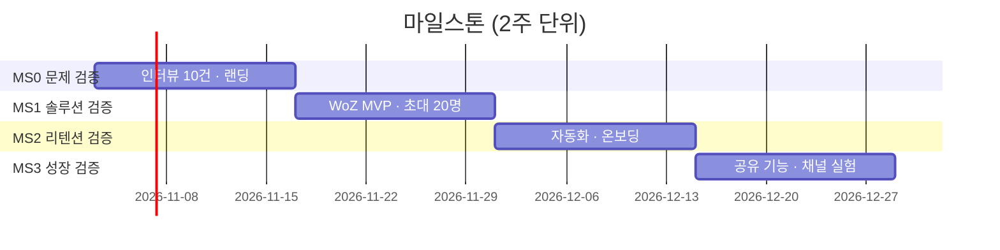

# MVP 정의와 마일스톤 설계

03-solution-and-mvp.md와 09-milestones.md를 쓸 때 읽으세요.

---

## Part 1. MVP

### 1.1 MVP 유형 선택표

"무엇을 만들까"보다 "**어떤 가설을, 얼마나 싸게**"가 먼저입니다. 가설 유형에 따라 적합한 MVP가 다릅니다.

| MVP 유형 | 검증에 적합한 가설 | 비용/기간 | 사례 (강의) | 한계 |
|---|---|---|---|---|
| **Landing page** (+대기 명단) | 문제가 존재하고 관심이 있는가 (H: 문제) | 1~2일 | — | 실제 사용 행동은 못 봄 |
| **Demo video** | 솔루션이 이해되고 원해지는가 | 2~3일 | Dropbox 2008 | 위와 같음 |
| **Concierge** (사람이 직접 서비스, 고객도 앎) | 솔루션이 가치를 주는가 (H: 가치) | 1주, 고객 5~10명 | — | 확장 불가, 가격 가설 왜곡 |
| **Wizard of Oz** (뒤에서 사람이 처리, 고객은 자동이라 믿음) | "자동화된 것처럼 보일 때" 사용자 행동 | 1주 | Zappos 1999 | 운영 부담, 10~30명 한계 |
| **Single-feature** | 핵심 기능 하나의 사용·재방문 (H: 가치, 리텐션) | 1~2주 | 강의 Todo v1 | 기능 선택이 틀리면 학습 0 |
| **Piecemeal** (기존 도구 조합: Notion+Zapier+Tally) | 워크플로우 전체의 가치 | 2~5일 | — | 이벤트 트래킹 제약 |

같은 제품이라도 마일스톤마다 MVP 유형이 바뀝니다: MS0 Landing page → MS1 Wizard of Oz → MS2 Single-feature.

### 1.2 In/Out 범위 표 작성 규칙

| 기능 | In/Out | 검증 가설 | 비고 |
|---|---|---|---|
| 할 일 입력·목록 | In | H1 | 없으면 아무것도 측정 불가 |
| AI 우선순위 추천 (상위 3개) | In | H2 | 핵심 가설. MS1에서는 Wizard of Oz로 사람이 정렬 |
| 추천 수락/거절 버튼 | In | H2 | **측정 장치**. 수락률 = M2 지표 |
| 완료 체크 | In | H3 | 완료율 측정 |
| 삭제·수정 | Out | — | 과제 1 피드백에 있었으나 어떤 가설도 검증 안 함 → MS2 |
| 캘린더 연동 | Out | — | 성장 가설 단계(MS3) |
| 다크 모드 | Out | — | 강의 Cycle 1: 사용률 5% — 기각됨 |

규칙:
1. In 항목에 가설 ID가 없으면 Out으로 보냅니다. 예외는 "측정 장치"(이벤트, 수락 버튼)와 "최소 동작 조건"(로그인)뿐이며 비고에 그렇게 적습니다.
2. Out 항목에는 "언제/어떤 조건에서 다시 보는지"를 적습니다. 거절이 아니라 연기입니다.
3. In 항목 합계의 구축 기간을 추정하고 **1인 2주**를 넘으면 In을 줄입니다. 줄일 때는 치명도가 낮은 가설부터.

### 1.3 MVP 성공 기준 쓰는 법

나쁜 예: "사용자들이 만족한다", "재방문이 늘어난다".
좋은 예: "초대 20명 중 **8명 이상(40%)** 이 첫 세션에서 추천을 1회 이상 수락하고(M2), 그중 **50% 이상** 이 7일 내 재방문(M4)".

성공 기준은 05-metrics.md의 목표치를 **그대로 인용**합니다. 다른 숫자가 두 곳에 있으면 validate 단계에서 사람이 잡아야 합니다.

### 1.4 흔한 실수

- **완제품 축소판**: "로그인, 프로필, 설정, 알림, 할 일, 추천…" — 모든 기능을 조금씩. 강의의 "바퀴→섀시→자동차" 오류.
- **측정 장치 누락**: 기능은 만들었는데 수락/거절, 이벤트가 없어 Measure 불가.
- **성공 기준 없이 출시**: 결과를 보고 나서 기준을 정하면 항상 "성공".

---

## Part 2. 마일스톤

### 2.1 마일스톤 = 검증 단위

전통 로드맵: "MS1 로그인·프로필, MS2 핵심 기능, MS3 알림". 기능 묶음.
린 로드맵: "MS0 문제 존재 검증, MS1 가치 가설 검증, MS2 리텐션 검증, MS3 성장 엔진 검증". **가설 묶음.**

각 마일스톤은 다음을 가집니다.

| 요소 | 설명 |
|---|---|
| 검증 가설 | 01의 H#. 반드시 1개 이상. MS0는 가장 위험한 가정 |
| 산출물 | 그 가설을 검증하는 데 필요한 **최소** 산출물 (MVP 유형 포함) |
| 종료 조건 | 05의 M# 목표치. 숫자. "완성되면"은 종료 조건이 아님 |
| Go / No-Go | Go → 다음 마일스톤. No-Go → 10의 Pivot 옵션 중 무엇으로, 또는 1사이클 재시도 조건 |
| 담당 | 07의 역할 |
| 기간 | 2주 고정 권장. 길어지면 가설을 쪼갭니다 |

### 2.2 전형적 4단계 (2주 × 4 = 8주)

| ID | 이름 | 검증 가설 | 전형적 산출물 | 전형적 종료 조건 |
|---|---|---|---|---|
| MS0 | 문제 검증 | 문제 존재·강도 | 인터뷰 10건, 랜딩+대기 명단 | 인터뷰 60%+ "주 1회 이상 겪음", 랜딩 전환 ≥ 15% |
| MS1 | 솔루션(가치) 검증 | 가치 가설 | Concierge/WoZ/Single-feature MVP | 활성화율 ≥ 40%, 핵심 행동 수락률 ≥ 50% |
| MS2 | 리텐션 검증 | "다시 오는가" | 자동화된 MVP v2, 온보딩 | D7 리텐션 ≥ 25%, 코호트 개선 |
| MS3 | 성장 엔진 검증 | 성장 가설 | 추천/공유 기능, 채널 실험 | K-factor ≥ 0.3 또는 CAC < LTV/3 |

과제(2주)에서는 MS0 또는 MS1 하나를 실제로 돌리고, 나머지는 계획으로 둡니다.

기간이 8주보다 짧을 때: 마일스톤을 빼지 말고 **압축**합니다. 6주 → MS0 1주 · MS1 2주 · MS2 2주 · MS3 1주. 4주 → MS0 1주 · MS1 3주, MS2·MS3은 각 2주로 설계하되 "데드라인 이후 계획"으로 표시. 네 단계는 검증 순서(문제 → 가치 → 리텐션 → 성장)이므로 하나를 빼면 검증 안 된 가설이 남습니다. 압축 결과는 `00-overview.md` 상단과 `11-bml-log.md` Cycle 0에 가정으로 기록합니다.

### 2.3 상세 블록 예

```
### MS1 — 솔루션 검증 (W3~W4)
- 검증 가설: H2 "AI가 정한 순서를 사용자가 따른다"
- MVP 유형: Wizard of Oz (추천은 PM이 매일 아침 수동 정렬, 사용자는 자동으로 인식)
- 산출물: 입력/목록/추천 수락·거절/완료 화면, PostHog 이벤트 4종, 초대 20명
- 종료 조건: M2 추천 수락률 ≥ 50% (20명 × 5일 = 100 추천 기준), M3 완료율 ≥ 60%
- Go: MS2로 (자동화 착수, 디자이너 합류)
- No-Go: 수락률 < 30% → Pivot 옵션 P1 (Zoom-in: 추천 대신 "오늘 하나만" 모드) 검토. 30~50% → 추천 설명 문구 바꿔 1사이클 재시도
- 담당: PM(수동 정렬·인터뷰), 풀스택(화면·이벤트)
```

### 2.4 GitHub 매핑 (강의 Section 08)

| PRD | GitHub |
|---|---|
| 마일스톤 MS0~MS3 | Milestones (due date = 2주 종료일) |
| 가설 H# | Issue (템플릿 `experiment.md`), 라벨 `hypothesis` |
| 실험 E# | Issue, 라벨 `experiment`, Projects 보드 Backlog→Running→Analysis→Shipped/Killed |
| 지표 M# | `scripts/metrics.yml` 수집 대상, 임계값 미달 시 자동 Issue |
| MVP In 기능 | Issue, 라벨 `mvp`, 본문에 `Validates: H2` |

### 2.5 Mermaid gantt 예


