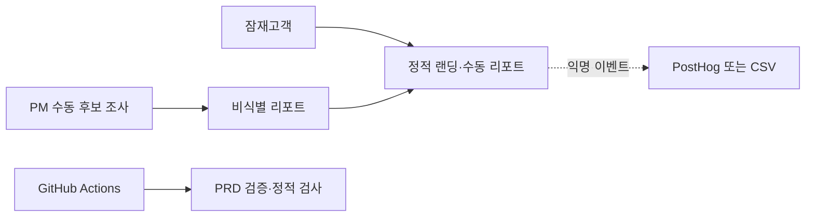

# 08. 기술 스택

| 제품 | 버전 | 최종 수정 | 관련 가설 |
|---|---|---|---|
| ArtGuard | 0.1 | 2026-10-30 | 전체 |

선택 원칙: 2주 내 첫 사용자 도달, 측정 가능성, 팀 숙련도, 무료·종량제 시작, Pivot 시 폐기 비용 최소화.

## 1. 아키텍처 개요

MS0~MS1은 이미지 처리 API나 자동 크롤러 없이 문제·리포트 가치를 검증한다.

## 2. 계층별 스택

| 계층 | 선택 | 선택 근거 (MVP 관점) | 검토한 대안 | 월 비용 (예상) | 리스크 / 전환 조건 |
|---|---|---|---|---|---|
| 프론트엔드 | HTML/CSS/TypeScript 정적 페이지 | 2일 내 랜딩·리포트 구현, 서버 비밀 없음 | Next.js는 MS0에 빌드 복잡도가 큼 | ₩0, 오픈소스·로컬 빌드 | 상태 흐름이 3개 화면을 넘으면 React/Vite 검토 |
| 백엔드 / API | 없음, PM 수동 Concierge | H2를 서버 없이 검증 | FastAPI는 가치 검증 전 운영비용 | ₩0 | 참여자 10명 또는 리포트 20건을 넘으면 FastAPI 검토 |
| 데이터 | 익명 CSV와 Git 비추적 private 원본 | 소표본 집계·감사가 쉬움 | PostgreSQL은 MS0에 과함 | ₩0 | 동시 편집 또는 100건 이상이면 관리형 PostgreSQL 검토 |
| 인증 | 공개 랜딩+일회성 비식별 리포트 링크 | H1/H2에 계정이 필요 없음 | OAuth는 핵심 가설과 무관 | ₩0 | 권한 분리·재방문이 M4 측정에 필수일 때 이메일 매직링크 검토 |
| 호스팅 / 배포 | GitHub Pages | 공개 저장소 정적 사이트에 사용 가능 | Vercel은 현재 기능에 불필요 | ₩0, [공식 문서](https://docs.github.com/en/pages/getting-started-with-github-pages/what-is-github-pages) 2026-10-30 확인 | 비공개 데이터·서버 처리가 필요하면 분리 호스팅 |
| 분석 · 실험 | CSV 우선, PostHog 무료 구간 | 이벤트·Feature Flag를 한 도구에서 확장 가능 | GA4는 제품 행동 분석이 약함 | ₩0, 월 분석 100만 이벤트·Feature Flag 100만 요청 무료 구간 [공식 가격](https://posthog.com/pricing) 2026-10-30 확인 | 무료 한도 또는 개인정보 요구 초과 시 셀프호스팅/대안 검토 |
| CI/CD | GitHub Actions | PR마다 Python 검증 자동화 | 수동 실행은 누락 위험 | 공개 저장소 표준 러너 ₩0, [공식 문서](https://docs.github.com/en/actions/concepts/billing-and-usage) 2026-10-30 확인 | 대형 러너·비공개 전환 시 비용 재산정 |
| AI/ML | MS0~MS1 미사용, 수동 비교 | 모델 품질보다 리포트 가치 가설을 먼저 검증 | CLIP·관리형 비전 API는 학습 목표를 앞섬 | ₩0 | M2 ≥ 50%와 평가용 정답 쌍 50개 확보 시 임베딩 비교 실험 |

### ADR-1: MS0~MS1은 자동 탐지 대신 Concierge

- 상황: 실사용자 문제·리포트 가치가 미검증이고 자동 크롤링·모델 도입은 비용과 법적 위험이 있다.
- 결정: 후보 수집과 근거 정리는 PM이 수동 수행하고 사용자 화면만 제품처럼 제공한다.
- 결과: 10영업일 내 H1/H2를 검증하며 모델 정확도와 제품 가치를 혼동하지 않는다.
- 되돌릴 조건: M2 ≥ 50%, 반복 수동 리포트 10건 이상, 합법적 데이터 출처와 정답 쌍 50개 확보.

## 3. 분석 · 실험 · Feature Flag

- 이벤트 수집: MS0 CSV, MS1부터 PostHog — 04 §3 이벤트 집합 사용
- Feature Flag: PostHog — MS2에서 `report_explanation_v2`를 베타 참여자 50%에만 노출
- 일일 지표: GitHub Actions는 비식별 집계만 처리하고 임계값 미달 시 실험 Issue 갱신
- 코호트: 첫 리포트 열람 주차, D7 재확인

## 4. 지금 하지 않을 것

| 하지 않을 것 | 다시 검토할 조건 |
|---|---|
| 자동 다중 마켓 크롤링 | H2 통과, 대상 사이트 약관·법적 근거 확인, 삭제 절차 마련 |
| 자동 저작권 침해 판정 | 제품 범위에서 제외; 전문가 판단을 대체하지 않음 |
| 자체 인증·OAuth | M4 측정에 계정 기반 재방문이 필수로 확인될 때 |
| 마이크로서비스·Kubernetes | 월 리포트 1만 건 또는 팀 8명 이상 |
| 모델 파인튜닝 | 정답 쌍 500개 이상과 사전학습 모델의 오탐 한도 초과가 확인될 때 |

