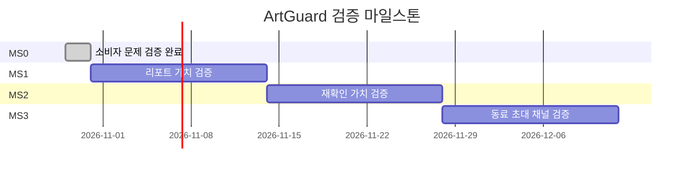

# 09. 마일스톤

| 제품 | 버전 | 최종 수정 | 관련 가설 |
|---|---|---|---|
| ArtGuard | 0.2 | 2026-10-30 | H1, H2, H3 |

마일스톤은 기능 묶음이 아니라 검증 단위이며 종료 조건은 05의 목표를 인용한다.

## 1. 마일스톤 개요

| ID | 이름 | 기간 | 검증 가설 | 핵심 산출물 | 종료 조건 | No-Go 시 |
|---|---|---|---|---|---|---|
| MS0 | 소비자 문제 검증 | W1~W2, 완료 | H1 | 실제 면담 5건, 집계·분석 | M1=100%(5/5), P1 반영 | P1 |
| MS1 | 소비자 리포트 가치 검증 | W3~W4 | H2 | 상품 URL 기반 수동 리포트 5건 이상 | M2 ≥ 50% | P2 |
| MS2 | 재확인 가치 검증 | W5~W6 | H2 | D7 후속 확인 링크·단일 기능 화면 | M4 ≥ 40% | P2 |
| MS3 | 동료 초대 채널 검증 | W7~W8 | H3 | 익명 초대 링크·채널별 문구 | M3 ≥ 20% | P3 |

## 2. 마일스톤 상세

### MS0 — 소비자 문제 검증 (W1~W2, 완료)

- 검증 가설: H1
- MVP 유형: Landing page + Interview
- 산출물: 익명 실제 면담 5건, 후속 테스트 신청, 집계 CSV와 분석
- 종료 조건: M1 ≥ 60% (적합 굿즈 소비자 최소 5명)
- 결과: M1=100%(5/5). P1 Customer Segment Pivot 승인·반영 후 종료.
- Go: MS1에서 상품 URL 기반 수동 리포트 실험 E2를 시작한다.
- No-Go: M1 < 40% → `10-risks-and-pivot.md` P1. 40~60% → 표본 10명까지 재실험.
- 담당: PM/연구자

### MS1 — 리포트 가치 검증 (W3~W4)

- 검증 가설: H2
- MVP 유형: Concierge/Wizard of Oz
- 산출물: 참여자가 제출한 상품 URL별 출처·라이선스·시각 비교 근거 리포트, 후속 행동 이벤트
- 종료 조건: M2 ≥ 50% (리포트 열람자 최소 5명)
- Go: MS2에서 반복 확인 단일 기능을 제공한다.
- No-Go: M2 < 30% → P2. 30~50% → 설명 변수 하나만 바꿔 1회 재실험.
- 담당: PM/연구자, 풀스택, 도메인 자문

### MS2 — 재확인 가치 검증 (W5~W6)

- 검증 가설: H2
- MVP 유형: Single-feature
- 산출물: 첫 리포트 후 D7 재확인 링크, 주차 코호트 이벤트
- 종료 조건: M4 ≥ 40% (첫 리포트 열람자 최소 5명)
- Go: MS3에서 초대 채널을 검증한다.
- No-Go: M4 < 20% → P2. 20~40% → 재방문 트리거 인터뷰 후 재실험.
- 담당: PM/연구자, 풀스택, ML/검색 자문

### MS3 — 동료 소비자 초대 채널 검증 (W7~W8)

- 검증 가설: H3
- MVP 유형: Piecemeal 초대 링크
- 산출물: 익명 초대 링크, 채널별 문구, 전환 집계
- 종료 조건: M3 ≥ 20% (고유 초대 열람 최소 10건)
- Go: 유효 채널의 반복 모집 비용과 운영 용량을 측정한다.
- No-Go: M3 < 10% → P3. 10~20% → 채널별 메시지를 분리해 재실험.
- 담당: PM/그로스, 풀스택

## 3. GitHub 매핑

| PRD 요소 | GitHub |
|---|---|
| MS0~MS3 | `MS0 Problem Validation` 등 2주 Milestone |
| H# | Issue, 라벨 `hypothesis` |
| E# | Issue, 라벨 `experiment`, Project: Backlog → Running → Analysis → Shipped/Killed |
| MVP In | Issue, 라벨 `mvp`, 본문 `Validates: H#` |
| M# | 비식별 집계 대상, 임계값 미달 시 실험 Issue에 기록 |

## 4. 일정

